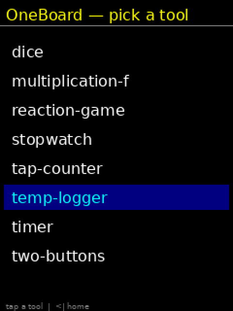

# OneBoard


A **self-installing, multi-client hardware canvas** built on the ESP32 CYD
(Cheap Yellow Display, 240×320). One board, many tools: it becomes whatever
you describe — a timer, a temp logger, a reaction game, a tap counter, a
stopwatch, a dice roller — **without ever reflashing the firmware**.

Any client can drive it and render its screen from the board's own
self-description: a web page, a Telegram bot, or an LLM.

> **New here? Start with [INSTALLING.md](INSTALLING.md)** — step-by-step from
> a bare machine to a live, controllable board (~20 min). **On Linux, run
> `./install.sh`** for a one-shot install of every dependency (PlatformIO,
> Python venv, serial permissions, optional store/Telegram services).

---

## Demo



One board, four tools, no reflash. These are the behaviors compiled into the
firmware itself — nothing is fetched, nothing is re-flashed. The panel is rendering
from the board's own self-description, the same `/schema` + `/state` + behavior JSON
any client reads.

Shooting it yourself: [`docs/DEMO-SHOTLIST.md`](docs/DEMO-SHOTLIST.md) covers the
from-scratch take (erase, flash, first boot, captive portal, then the builtins),
plus `tools/demo_drive.py` (cues you through the take and confirms every tap landed)
and `tools/render_frames.py` (turns the same recorded sequence into the GIF).

---

## What makes it different

- **No serial cable, no BOOT button.** First boot opens a captive portal —
  join the board's WiFi from your phone and the setup page auto-opens.
- **Behavior = data, not firmware.** A tool is a JSON description compiled to
  bytecode on the board at load time. New tools ship over WiFi from a store,
  not over USB.
- **Author with an LLM.** `tools/author.py "I want a dice roller"` → the model
  writes a schema-valid behavior, validates it, self-corrects, and pushes it
  to the live board. Done.
- **Any client renders it.** `/schema` describes the VM vocabulary, `/state`
  reports live values, and `tools/board_view.html` draws the board's screen in
  a browser from that description alone.
- **Controllable from Telegram.** A thin no-LLM bot (near-zero cost) drives
  `/load`, `/status`, `/tools`, `/schema` from your phone, anywhere.

---

## Hardware

| | |
|---|---|
| Board | CYD ESP32-2432S028R ("cheap yellow display") |
| Display | ILI9341 240×320 portrait, `setRotation(0)`, no inversion |
| Touch | XPT2046 on separate VSPI (CS33/MOSI32/MISO39/CLK25/IRQ36), 250 ms debounce, one event per press, no pull-up on IRQ36 |
| Display SPI | HSPI (MISO12/MOSI13/SCLK14/CS15/DC2/RST=-1/BL21) — `USE_HSPI_PORT` mandatory |
| MCU | ESP32 (espressif32 platform, Arduino framework), 4 MB flash |

`platformio.ini` carries the full pin map and all TFT/touch build flags.

> **Which boards work?** The 2432S028R (bench board) is hardware-verified. The
> common 2432S024 and 2432S032 variants have ready-made envs built from vendor
> schematics — see **[VARIANTS.md](VARIANTS.md)** for the full pin table,
> sources, and which configs still need a real-board test.

### The CYD pin problem (why the config matters)
The CYD is notorious for white-screen / broken-touch if the TFT and touch
share a SPI bus or the wrong port is used. This repo's `platformio.ini` is the
verified-good config: display on HSPI, touch on its own VSPI, `USE_HSPI_PORT`
set, fonts 2/4/6 loaded, `SPI_FREQUENCY 20 MHz`, touch 2.5 MHz. Do not "fix"
what is not broken here.

---

## Architecture

```
        +---------------------+        HTTP (store)         +------------------+
        |   tools/author.py   | --------------------------> |  store/serve.py  |
        |   (LLM authoring)    |   writes behaviors/*.json  |  (behavior store)|
        +---------------------+                             +--------+---------+
                                                                     |
        +---------------------+   /load  /store  /wifi   <-----------+
        |   web page (board)  | <====================================+
        +---------------------+     (compiled to bytecode, no reflash)
        +---------------------+   /status /state /schema
        |  board_view.html    | <------------------------------------+
        |  (browser renderer) |                                       |
        +---------------------+                                       |
        +---------------------+   /status /tools /load /schema        |
        |  oneboard_bot.py    | <------------------------------------+
        |  (Telegram control) |     (thin, no-LLM)
        +---------------------+
```

**Firmware side (`src/`):**
- `main.cpp` — HTTP server, WiFi provisioning, captive portal, behavior loader
- `vm.h` / `vm.cpp` — the bytecode VM: 26 instruction types, 9 guard ops,
  JSON→bytecode compilation at load (ArduinoJson on the cold path only)

**Host side (`tools/`, `store/`, `systemd/`):**
- `author.py` — LLM behavior authoring pipeline (OpenRouter/DeepSeek-V4-Flash)
- `validate_behavior.py` — schema validator (catches format errors, not
  semantic lies — hardware is the only true gate)
- `board_view.html` — any-client screen renderer (browser)
- `oneboard_bot.py` — Telegram control (installed as a systemd user service
  by `install.sh --with-telegram`)
- `serve.py` — the behavior store (this machine, port 8082); advertises itself
  over mDNS so boards find it without being told an address
- `mdns_advertise.py` — stdlib-only mDNS/DNS-SD responder (`_oneboard-store._tcp.local`)

---

## Behavior model (the "language" of a tool)

A behavior is JSON with **typed state slots** and **event handlers**:

```json
{
  "id": "my-tool",
  "name": "Human-Readable Name",
  "state": [
    {"name": "running", "type": "bool",   "init": true},
    {"name": "elapsed", "type": "int64",  "init": 0},
    {"name": "label",   "type": "string", "init": "00:00"}
  ],
  "events": [
    {"name": "tick", "schedule": {"type": "interval", "ms": 1000},
     "handlers": [{"guard": {"op": "eq", "a": {"slot": "running"}, "b": {"lit": true}},
                   "run": [ ...verbs... ]}]}
  ]
}
```

- **Slots** are typed (`int64`, `float`, `bool`, `string`) and fixed — the VM
  never creates variables, every value references a slot. Max 12.
- **First-match-guard-wins**: on an event, run the first handler whose guard
  matches, then stop. Order matters.
- **Verbs** are straight-line lists (no loops, no recursion): `add`, `sub`,
  `mul`, `div`, `mod`, `clamp`, `set`/`setf`, `toggle`, `stamp`, `random`,
  `now_minus`, `format`, `progress`, `render`, `if` (bounded forward branch).
  `div`/`mod` guard divide-by-zero (→ 0); `clamp` takes `{slot, min, max}`.
- **Render primitives**: `clear`, `text`, `rect`, `fillrect`, `line`,
  `circle`, `bar`, `graph`. Colors from a fixed palette.
- **`clear` is a full-screen fill** (~61 ms of SPI at 20 MHz, measured), so it
  belongs at the start of a new screen — never inside a repeating tick. To update
  a value every tick, give the text `"bg": "black"`: it blanks its own box first
  (~6 ms, ~10x cheaper) and takes optional `w`/`h` to reserve a fixed box for a
  value whose width changes. The validator warns about a fast-tick `clear`.
- **Guards**: `eq ne lt le gt ge`, `is_true`, `elapsed_ge`, `always`.
- **Limits**: 12 slots, 20 render primitives, 80 instructions, 6 events.

Full authoring reference: [`docs/BEHAVIOR-AUTHORING.md`](docs/BEHAVIOR-AUTHORING.md).

---

## Board HTTP API

| Endpoint | Purpose |
|---|---|
| `/` | Self-describing web page (tools render dynamically from the store) |
| `/status` | `{tool, store_url, loaded, wifi, provisioning, ip, store_auto, store_found}` |
| `/state` | Live VM slots (`name, type, value`) + render primitives |
| `/schema` | The VM vocabulary — what an LLM needs to author a behavior |
| `/load?id=<tool>` | Compile + run a behavior from the store |
| `/delete?id=<tool>` | Purge a tool's cached copy from the board's LittleFS (the store's DELETE is authoritative) |
| `/store?url=...` | Point the board at a behavior store by hand (switches automatic discovery off) |
| `/store?auto=1` | Re-enable automatic discovery and go look for a store now |
| `/discover` | Browse mDNS for a store, on demand |
| `/wifi?ssid=&pass=` | Join home WiFi (persisted in NVS; never in the repo) |
| `/scan` | Nearby 2.4 GHz networks as JSON — powers the setup page's pick-a-network list. `/scan?start=1` begins an async scan; poll `/scan` until `state` is `done` |

The store (`store/serve.py`) additionally accepts `DELETE /delete?id=<tool>` to
remove a behavior for good — that's what drops it from `/tools` and the web
page. Firmware built-ins (`timer`, `temp-logger`, `reaction-game`,
`tap-counter`) are protected from deletion.

Captive-portal probes (`/generate_204`, `/hotspot-detect.html`, Apple/Google/
Microsoft hosts) are intercepted with a 302 to the setup page when the board is
in provisioning mode (no saved WiFi).

---

## Tooling

### Author a tool with an LLM
```bash
python3 tools/author.py "I want a dice roller that rolls 1-6" --board 192.168.1.206
```
The pipeline: LLM writes JSON against the board's vocabulary → validator →
bounded self-correction loop → `behaviors/<id>.json` → pushed live to the board.

> **Provider note:** the OpenRouter DeepSeek-V4-Flash calls must include
> `"reasoning": {"enabled": false}` or the model burns its whole token budget
> on invisible reasoning and returns `content: None`. `author.py` handles this.

### Validate a behavior offline
```bash
python3 tools/validate_behavior.py examples/store-only/dice.json   # sanity check first
```

### View the board's screen in any browser
Open `tools/board_view.html` (or `http://<board>/`) — it renders the screen from
`/schema` + the behavior JSON + `/state`, with live state and simulate-tap.

### Control from Telegram
Message `@OneBoardControl_bot`:
`/status` — current tool + WiFi + IP
`/tools` — list available behaviors
`/load <id>` — load an existing behavior onto the board
`/make <request>` — author a NEW behavior and push it to the board (delegates
  to `tools/author.py`, the LLM stage-4 pipeline; takes ~30-90s — it validates,
  self-corrects, and pushes over the wire, no reflash)
`/delete <id>` — remove a tool from the store (and the board's cached copy)
  so it disappears from `/tools` and the web page
`/schema` — the VM vocabulary
`/help`

Runs as the systemd user service `oneboard-tg-bot` (see `systemd/`).
Token lives in `~/.hermes/keys/oneboard-telegram.env` (0600) — never in the repo.
`/make` reuses the bot's own `ONBOARD_BOARD_IP` / store URL and runs author.py
in the project venv.

### Run the store
```bash
python3 store/serve.py --port 8082
```
(8082 is used here because 8080 is occupied by a local docker-proxy.)

---

## Built-in behaviors

`behaviors/` holds exactly the four tools that ship with the firmware, loadable
over the wire from the store:

`timer` · `temp-logger` · `reaction-game` · `tap-counter`

All four are also embedded in firmware as PROGMEM fallbacks (offline boot), and
those four are protected from store deletion. Tools created by `/make` (or added
to `behaviors/`) are store-only and can be deleted freely.

`examples/store-only/` keeps four more worked examples — `dice`, `stopwatch`,
`multiplication-f`, `two-buttons` — deliberately outside `behaviors/` so a fresh
store lists only what the firmware comes with. Copy one in to serve it.

---

## Project history / stages

| Stage | What shipped |
|---|---|
| 1 | Web-toggled demo — display, touch, state on hardware |
| 2 | Behavior store — tools as data, `/store` + `/load` over WiFi |
| 3 | Bytecode VM — JSON→bytecode compiled at load, no ArduinoJson on the hot path |
| 4 | Turnkey authoring — `author.py`, validator, `/schema`, `random` verb |
| 5 | Captive-portal provisioning — no serial, no BOOT button |
| 6 | Telegram control — thin no-LLM bot, systemd service |
| 7 | Any-client rendering — dynamic web page, `/state`, `board_view.html` |

---

## Dev / build

```bash
pio run                    # build
pio run -t upload          # flash over USB (/dev/ttyUSB0)
pio run -t monitor         # serial log, 115200 baud
```

WiFi password is stored only in the board's NVS — never committed, never asked
for in chat.

---

## License

MIT — see [LICENSE](LICENSE).
